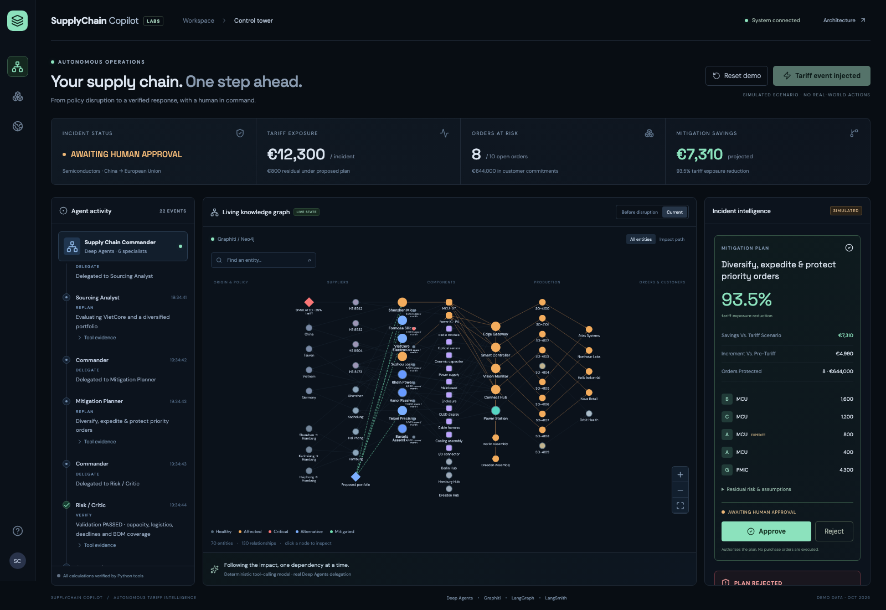
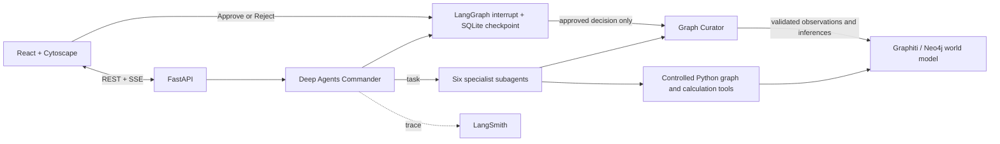

# SupplyChain Copilot

**Autonomous Tariff Impact & Mitigation** — a local hackathon control tower built around investigation, a rejected sourcing plan, recovery, and human approval. No chat box.



## Documentation

- [Data guide](docs/DATA_GUIDE.md): entities, relationships, field meanings, suppliers, BOMs, orders, inventory, tariff inputs, calculations and temporal evidence.
- [Solution architecture](docs/ARCHITECTURE.md): overall diagram, investigation/approval sequence, component responsibilities, APIs, runtime modes and persistence.
- [Architecture diagram — SVG](docs/architecture.svg): standalone visual for presentations and viewers without Mermaid support.
- [LangChain stack](docs/LANGCHAIN_STACK.md): how Deep Agents, LangChain, LangGraph and LangSmith are used, with versions, code references and official documentation.
- [API audit](docs/API_AUDIT.md): verified framework APIs, compatibility adjustments and verification limits.

## Run locally

Prerequisites: [uv](https://docs.astral.sh/uv/), Python **3.12**, Node **22.12+** (tested with 23.11), and Docker for Neo4j. Install dependencies once; the default deterministic model and structured Graphiti path need no API key or internet during the demo.

```bash
uv sync --frozen
cd frontend
npm ci
cd ..
cp .env.example .env
docker compose up -d --wait
uv run python -m backend.seed
bash scripts/dev.sh
```

Open **http://127.0.0.1:5173**. API docs: http://127.0.0.1:8000/docs. Neo4j Browser: http://localhost:7474 (`neo4j` / `supplychain-demo`). Demo-only credentials are configurable in `.env`. Ports bind the application to localhost; this prototype has no authentication and is intended for a local demo.

Or start in separate terminals:

```bash
uv run python -m uvicorn backend.api.main:app --host 127.0.0.1 --port 8000
```

```bash
cd frontend
npm run dev
```

**Without Docker:** set `MEMORY_MODE=local` in `.env` (or use `MEMORY_MODE=local bash scripts/dev.sh`). This is an explicitly labelled SQLite temporal fallback, **not a Graphiti-backed run**. Deep Agents delegation, calculations, the deliberate failure, SQLite checkpoints, and approval all still run. If `.env` is absent, the app defaults to this local mode. A failed connection in Graphiti mode fails startup visibly instead of silently changing modes.

## Modes and credentials

| Setting | Behavior |
| --- | --- |
| `AGENT_MODE=deterministic` | Real Deep Agents harness, scripted offline tool-calling model; no LLM inference is claimed. Recommended for repeatable demos. |
| `AGENT_MODE=live` | Same Commander, tools, six declarative subagents and approval gate with `ChatOpenAI`; requires `OPENAI_API_KEY`. Model set by `OPENAI_MODEL`. |
| `MEMORY_MODE=graphiti` | Real Graphiti nodes, episodes, temporal edges and provenance in Neo4j. Agent tools load the supply graph from Neo4j and read shared policy evidence before impact analysis. |
| `MEMORY_MODE=local` | SQLite temporal journal plus the identical deterministic fixture. Explicit fallback label in the UI. |
| `GRAPHITI_EXTRACT=true` | Optional LLM episode extraction through `Graphiti.add_episode`; requires an API key. Structured episodes are retained if extraction fails or times out. Extracted candidates stay in a separate staging namespace and cannot bypass the curator. |
| `LANGSMITH_TRACING=true` | Enable LangSmith with `LANGSMITH_API_KEY` and `LANGSMITH_PROJECT`. |

Live mode requires internet and may produce a different delegation cadence. The deterministic plan builders and independent critic calculate all quantities and reject invalid plans in either mode. Approval is blocked until all six roles have investigated, an initial plan has failed, and a revised plan has passed verification.

## 3-Minute Demo Script

1. **0:00–0:25 — Healthy network.** Open the dashboard; point out 8 suppliers, 12 components, 5 products, 10 orders, and the current model/memory mode. Click a supplier to inspect properties and relationships. Close the inspector.
2. **0:25–0:45 — Inject.** Click **Inject Tariff Event**. Explain that this is a SIMULATED 25% Chinese semiconductor tariff, announced October 26 and effective November 15, 2026. The policy node connects country and HS code.
3. **0:45–1:10 — Investigate.** Follow the actual backend tool events. The Commander delegates policy, impact, inventory and sourcing. Suppliers A/D and components MCU/PMIC are direct impact; four products, two plants, eight orders and four customers are downstream impact. Select **Impact path** or zoom for a closer view. Open **Tool evidence** to inspect the calculation inputs.
4. **1:10–1:35 — Fail visibly.** Supplier B is the cheapest qualified MCU alternative. The first proposal moves 4,000 units to B. The Critic rejects it: only 2,000 units/month of spare capacity. Point out **PLAN REJECTED** and the capacity constraint.
5. **1:35–2:00 — Recover.** The Commander delegates sourcing/planning again. Revised MCU allocation: B 1,600; C 1,200; A 800 expedited before tariff, plus A 400 regular. PMIC: G 4,300. The Critic checks aggregate capacity, qualifications, demand coverage, production deadlines, dispatch limits and port delays.
6. **2:00–2:30 — Human decision.** The plan awaits approval. Show **€7,310** projected savings against the tariff scenario, **93.5%** tariff reduction, **€4,990** incremental cost against pre-tariff procurement, and **8 / €644,000** orders protected. Review residual risks. Click **Approve**. The interrupt resumes; the approved decision becomes a temporal memory fact and orders turn green. No purchase orders are actually executed.
7. **2:30–3:00 — Time and trace.** Toggle **Before disruption / Current**; inspect Supplier A’s MCU landed cost (€8.50 → €10.50). With LangSmith enabled, open **LangSmith trace** in the header. Show the task delegations, tool calls, failure, replan, and human resume. Use **Reset demo** for another run. A logical evidence clock advances across rehearsals so newer confirmations never backdate earlier runs.

`DEMO_STEP_DELAY=0.8` controls a short pause after real tool events so the roughly 20-second deterministic investigation is legible; it does not replace tool execution with a canned timeline.

## Architecture



Backend components:

- `backend/models`: typed entities, facts, policy event, allocations and evaluations.
- `backend/data`: committed, deterministic JSON. `scripts/generate_data.py` regenerates it; runtime uses the committed data.
- `backend/tools`: controlled graph traversal, inventory, qualification, logistics, landed costs and simulation. Agents receive no arbitrary Cypher tool.
- `backend/agents/commander.py`: `create_deep_agent` with six isolated declarative subagents, planning middleware and task delegation. `deterministic_model.py` implements the explicit offline model fixture.
- `backend/engine.py`: runs tools, publishes structured activity/evidence events, maintains graph risk overlays and requests approval.
- `backend/graph`: safe curator and temporal persistence. Graphiti public `EntityNode`, `EntityEdge`, `EpisodicNode` and `EpisodicEdge` persistence APIs avoid making extraction availability part of the critical path. In Graphiti mode the persisted BOM/topology is read back into the tools, and impact analysis requires policy evidence retrieved from Graphiti.
- `backend/api`: REST and SSE. Checkpoints, mode-specific incident state and temporal journals persist under ignored `runtime/`.
- `frontend`: React/TypeScript, Cytoscape, bundled fonts and local assets. Graph categories, risk colors, search, selection, zoom, entity relationships, evidence, current/before toggle and approval.

The UI displays structured actions and evidence, not private model reasoning. Candidate allocations are proposals. Green orders represent protection under the approved plan, not completed deliveries or executed procurement.

## Why Deep Agents?

The application uses `create_deep_agent`, its planning tool and built-in `task` delegation to six declarative specialist agents. Each specialist has a narrow tool and isolated context. This is an actual harness in both modes; deterministic mode substitutes a transparent `BaseChatModel` fixture for remote model sampling. Live mode changes only the model, preserving the tools and gates. The Commander owns investigation and recovery; the Critic independently evaluates the proposed allocations.

The six agents are Policy Analyst, Impact Analyst, Inventory & Operations Analyst, Sourcing Analyst, Risk / Critic, and Mitigation Planner. Numeric work is always delegated to Python; neither model mode is allowed to invent costs, quantities or capacity.

## Why Graphiti?

Graphiti is the shared temporal world model, not a visualization adapter. Seeded supplier/BOM/order relations are persisted as Graphiti entity edges with a seed-episode provenance. Structured policy, confirmed evidence, rejections, and approved decisions are episodes. Curated facts link their source episodes to their subjects. Policy evidence is read by the Impact Analyst, and tools traverse the topology read from Neo4j.

Facts distinguish **OBSERVATION**, **INFERENCE** and **DECISION**. The curator checks required typed fields, subject existence, allowed predicates, source-episode existence, confidence ≥0.90, duplicates, and approval for decisions. Current facts supersede earlier facts by setting `invalid_at`; historical facts remain queryable. The local mode provides the same temporal contract with SQLite for offline fallback.

`/api/memory?subject=A` returns current evidence; add `&as_of=2026-10-25T12:00:00%2B00:00` for the historical view. The UI’s before/current toggle is a small deterministic baseline snapshot, not an arbitrary-date time-travel editor. The Graphiti adapter uses controlled exact queries; feature-hash vectors satisfy the current save API’s vector requirement. They are not represented as semantic embeddings. Optional extraction uses this same local embedder and retains structured evidence if the LLM step fails. Its candidate entities and edges stay in the `supplychain-copilot-extraction` namespace, outside the curated world model.

## Failure Recovery

The first candidate deliberately optimizes visible MCU landed cost before independent feasibility review. Supplier B costs €9.00/unit versus tariffed A’s €10.50, but moving 4,000 units to B exceeds its 2,000-unit spare capacity. The Critic rejects the proposal and records why.

The revised heuristic caps B at 40% and C at 30% of MCU shortfall, uses A’s 800-unit pre-tariff dispatch window, and retains the remainder at A. It moves PMIC procurement to qualified G. All splits are computed from demand, stock and supplier properties. The Critic then checks total volume **per supplier across all allocation rows**, component coverage, qualification, dispatch limits, port-adjusted arrival and production deadlines. Concentration is disclosed as a residual risk.

Inventory is reserved on paper for higher-margin orders first; those reservations remain proposals until human approval. API/tool failures enter a visible error state, preserve logging, and allow a reset. Process restart during investigation reports an interrupted-run error; reset starts a new thread. Restart while awaiting approval preserves the checkpoint and can resume the pending decision.

## Human-in-the-Loop

`request_mitigation_approval` calls current LangGraph `interrupt()` inside the Commander’s tool. `AsyncSqliteSaver` persists the checkpoint under a stable thread ID. `/api/decision` resumes with `Command(resume="APPROVE")` or `"REJECT"`. Only the approval branch commits a `DECISION`. Invalid, repeated and premature approval requests are rejected. The approval endpoint waits for the investigation task to finish persisting its interrupt to avoid a UI/checkpoint race.

Consequential action here is approval of a sourcing strategy. There are deliberately no ERP, payment, email or purchase-order execution integrations.

## Calculations and assumptions

All prices are synthetic **EUR**; no FX conversion or news API is needed. This is a single November procurement window, using event-relative planning dates rather than the machine clock.

| Quantity | Formula / result |
| --- | --- |
| Tariff | Affected import unit price × quantity × 25%; customs value excludes freight in this simple model |
| Landed unit cost | Unit price + freight + tariff on unit price + modeled expedite premium |
| Shortfall | max(0, BOM demand − stock − incoming arriving by earliest relevant deadline) |
| MCU procurement | 4,600 demand − 400 stock − 200 valid incoming = 4,000 |
| PMIC procurement | 4,600 demand − 200 stock − 100 valid incoming = 4,300 |
| Pre-tariff baseline | €52,490 for affected procurement |
| Tariff baseline | €64,790 including €12,300 tariff |
| Revised plan | €57,480 including €800 residual tariff |
| Savings | €64,790 − €57,480 = €7,310 |
| Incremental cost | €57,480 − €52,490 = €4,990 |
| Tariff reduction | (€12,300 − €800) / €12,300 = 93.50% |
| Protected orders | 8 affected orders, €644,000 total value, only if all modeled constraints pass |

Regular incumbent replenishment is booked for November 17. Expediting A uses a four-day lead time and a maximum 800-unit early dispatch window. Alternative lead times include port delays; production requires three days. Orders are due November 25–27. Existing inventory and incoming stock were imported before the tariff and incur no new tariff. Supplier spare capacity already excludes other committed demand. Non-incident components have sufficient seeded stock. Cost comparisons cover only the affected procurement, not the whole company’s P&L. Capacity is a single-window cap, not a multi-period optimization model.

## LangSmith

Set these in `.env`, then restart the backend:

```dotenv
LANGSMITH_TRACING=true
LANGSMITH_API_KEY=your_key
LANGSMITH_PROJECT=supplychain-copilot
```

The header links the investigation trace when tracing is enabled. Deep Agents and LangChain emit model, task and tool spans; deterministic Python traversals and simulations are decorated with `traceable`. Metadata includes incident ID, run/thread ID, simulation marker and model mode. Approval resume is a separate traced invocation using the same checkpoint thread; correlate it by `demo_run` metadata. Tracing is optional and cannot be demonstrated online without the user’s credentials. Do not set tracing on for the fully offline rehearsal.

## Validation

```bash
uv run pytest -q
cd frontend
npm run build
```

Optional real database integration, against an isolated demo Neo4j database:

```bash
docker compose up -d --wait
RUN_NEO4J_TESTS=1 uv run pytest tests/test_graphiti_integration.py -q
```

Browser test (with backend + frontend already running and no active investigation):

```bash
cd frontend
npx playwright install chromium
npx playwright test
```

The browser test resets the demo, runs injection through rejection/recovery/approval, checks the before toggle and inspector, and captures desktop/mobile screenshots into `docs/`. Python tests cover calculations, seed integrity, downstream traversal, first rejection, second acceptance, curator validation, temporal supersession, real Deep Agents delegation, approval exclusion, rejection, API guards and restart/resume using SQLite checkpoints. The Neo4j test is opt-in in the ordinary suite. A repeated-rehearsal regression runs a second investigation against the same temporal memory.

## Current API audit and dependency versions

Official APIs were inspected before implementation; installed signatures and the resolved dependency set were then checked. Python and frontend lockfiles are committed. See [the API audit](docs/API_AUDIT.md) for links, compatibility notes and verified signatures.

Core pins: Python 3.12; Deep Agents 0.7.32; Graphiti 0.31.2; LangGraph 1.2.17; LangSmith 0.14.12; LangChain OpenAI 1.7.2; FastAPI 0.162.0; Pydantic 2.14.1; Neo4j Community 5.26.0; React 19.3.1; Vite 8.3.5; TypeScript 7.0.2; Cytoscape 3.34.4. Exact transitive versions are in `uv.lock` and `frontend/package-lock.json`.

## Troubleshooting

- **Graphiti startup fails:** verify `docker compose ps`, credentials and Bolt port 7687. Use `MEMORY_MODE=local` if infrastructure is unavailable; the UI will say local explicitly.
- **UI says connecting:** backend must be running on 8000; Vite proxies `/api` there. Check `http://127.0.0.1:8000/api/health`.
- **Approval button absent:** wait for verification, close an entity inspector, and check the top of the scrollable right panel. A rejected human decision needs a reset before another incident.
- **Model API fails:** switch to `AGENT_MODE=deterministic` and restart. Live mode errors are displayed; there is no silent fallback pretending to be live inference.
- **New rehearsal:** click Reset. Historical episodes remain in memory. App state is single-demo-instance; run one backend worker.
- **Fresh storage:** stop the app and rename `runtime/`. To clear only this demo’s Neo4j namespace, use Neo4j Browser: `MATCH (n) WHERE n.group_id = 'supplychain-copilot' DETACH DELETE n`. This deletes demo memory; it is not part of the reset button.
- **Vector saves:** Graphiti 0.31.2 calls Neo4j vector procedures even when embeddings are absent; local 1024-dimensional feature-hash vectors avoid null-vector errors. See the audit.

This is a single-user hackathon prototype. Multi-tenant authorization, multi-process coordination and transactional integration with ERP systems are outside its scope.
