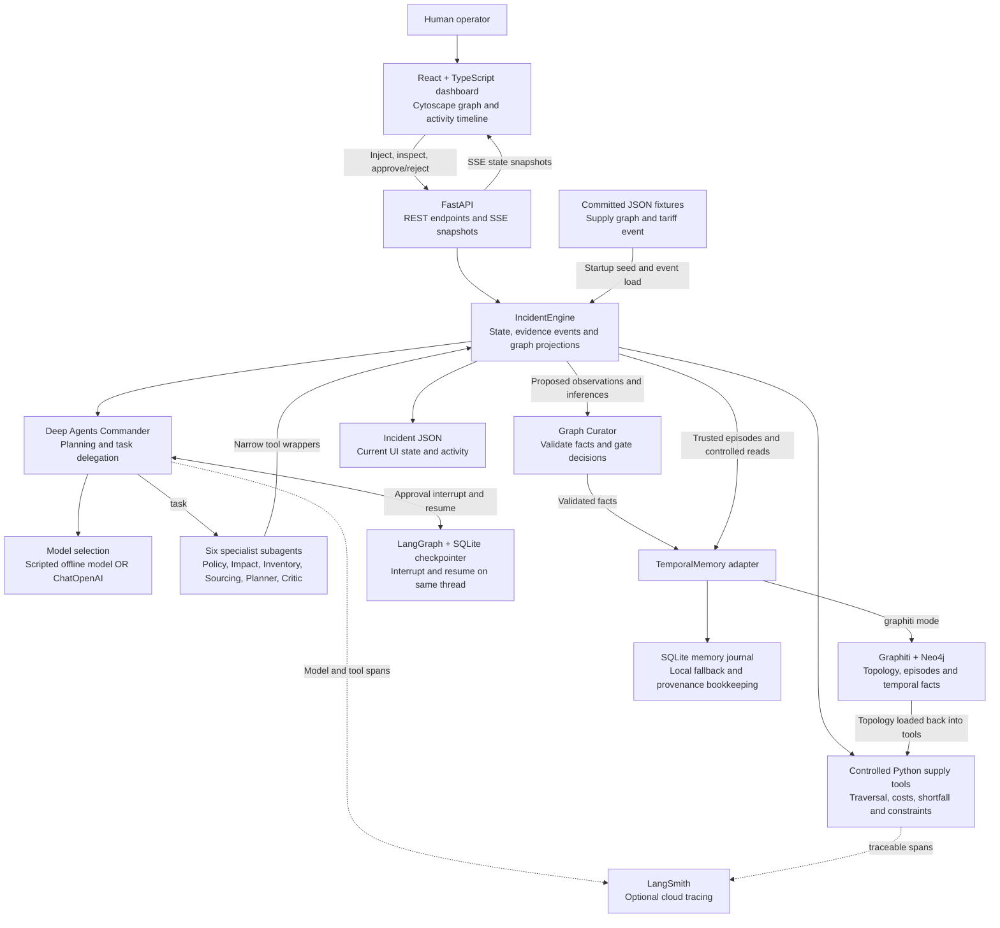

# Solution architecture

SupplyChain Copilot turns a simulated policy event into a traced investigation, a rejected proposal, a revised plan and a human decision. This describes the implemented application; future custom-event injection is not shown as an existing capability.

[Data guide](DATA_GUIDE.md) · [LangChain stack](LANGCHAIN_STACK.md) · [Setup and demo](../README.md)

## 1. Overall architecture

The Mermaid diagram below is editable text. A standalone [SVG diagram](architecture.svg) is also available for presentations and Markdown viewers without Mermaid support.



The two memory modes are alternatives for business-memory retrieval. The SQLite checkpoint remains in use in **both** modes. In Graphiti mode, the memory adapter also maintains a SQLite journal; selecting Graphiti does not eliminate all local files.

## 2. Components and responsibilities

| Component | Responsibility | Implementation |
| --- | --- | --- |
| Dashboard | Inject the fixture event, visualize activity/graph, inspect evidence, approve/reject | [`frontend/src/main.tsx`](../frontend/src/main.tsx), [`components/`](../frontend/src/components/) |
| API | Serve state, graph and temporal memory; start investigation; resume approval; stream snapshots | [`backend/api/main.py`](../backend/api/main.py) |
| Incident engine | Coordinate tool operations, record evidence, emit events and maintain risk overlays | [`backend/engine.py`](../backend/engine.py) |
| Commander | Plan with `write_todos`, delegate via `task`, request approval | [`backend/agents/commander.py`](../backend/agents/commander.py) |
| Offline model | Emit deterministic tool calls through the actual agent runtime | [`deterministic_model.py`](../backend/agents/deterministic_model.py) |
| Supply/calculation tools | Calculate scope, BOM demand, alternatives, landed costs and plan feasibility | [`backend/tools/`](../backend/tools/) |
| Curator | Validate proposed facts and reject unapproved decisions | [`backend/graph/curator.py`](../backend/graph/curator.py) |
| Temporal adapter | Persist/retrieve episodes, seed/read topology, supersede facts | [`graphiti_client.py`](../backend/graph/graphiti_client.py) |
| Local embedder | Generate non-null feature-hash vectors for Graphiti storage | [`embeddings.py`](../backend/graph/embeddings.py) |
| Configuration | Load `.env` and choose independent model and memory modes | [`backend/config.py`](../backend/config.py) |

The application is one FastAPI process, not six separately deployed agent services. Specialist tools are narrow LangChain wrappers around `engine.investigate(role)`. That dispatcher invokes the deterministic methods. Agents do not receive arbitrary Cypher access or independent database write credentials through their tools.

## 3. Investigation and recovery sequence

```mermaid
sequenceDiagram
  actor H as Human
  participant UI as Dashboard
  participant API as FastAPI / Engine
  participant C as Deep Agents Commander
  participant A as Specialist subagents
  participant T as Python tools
  participant M as Curator / Temporal memory
  participant CP as LangGraph checkpoint

  H->>UI: Inject Tariff Event
  UI->>API: POST /api/incidents
  API->>M: Store tariff episode and provenance links
  API->>C: ainvoke(messages, thread_id)
  C->>C: write_todos
  C->>A: task: Policy, Impact, Inventory, Sourcing
  A->>API: Execute role-specific tool wrappers
  API->>T: Read scope/BOM/stock/offers and calculate
  API->>M: Record episodes and validated facts
  API-->>UI: SSE snapshots with evidence and risk updates
  C->>A: task: Planner
  A->>T: Build first candidate via engine
  T-->>A: B allocated 4,000 MCU units
  C->>A: task: Critic
  A->>T: Independently simulate allocations
  T-->>A: FAIL: B spare capacity is 2,000
  API-->>UI: PLAN REJECTED
  C->>A: task: Sourcing, Planner, Critic again
  A->>T: Build and verify revised portfolio
  T-->>A: PASS with computed costs and residual risks
  C->>API: request_mitigation_approval
  API->>CP: interrupt(plan and evaluation)
  CP-->>C: Pause and persist checkpoint
  API-->>UI: AWAITING HUMAN APPROVAL
  H->>UI: Approve or Reject
  UI->>API: POST /api/decision
  API->>C: ainvoke(Command(resume=decision), same thread_id)
  C->>CP: Resume interrupted tool
  alt Approved
    API->>M: Commit approved DECISION and supporting episode
    API-->>UI: APPROVED and mitigated order overlays
  else Rejected
    API->>M: Record rejection episode; no approved decision
    API-->>UI: REJECTED
  end
```

API/engine tool calls above show the logical flow. Framework spans contain the detailed nested model, delegation and tool execution. The UI displays structured operations and evidence, not private model reasoning.

## 4. Agents and exposed tools

| Subagent | Tool exposed to that subagent | Work performed by the engine |
| --- | --- | --- |
| Policy Analyst | `parse_policy` | Read structured policy; record observations and tariffed landed costs |
| Impact Analyst | `get_downstream_impact` | Require shared policy evidence; traverse supplier/component/product/order dependencies; calculate exposure |
| Inventory Analyst | `get_inventory` | Net stock and valid incoming supply against BOM demand; propose priority reservations |
| Sourcing Analyst | `find_alternative_suppliers` | Compare qualified offers by landed cost; include capacity and port/lead-time evidence |
| Mitigation Planner | `simulate_sourcing_plan` | Build the initial or revised candidate using deterministic plan builders |
| Risk / Critic | `check_supplier_capacity` | Run the broader independent simulation: capacity, qualification, volume, arrival, dispatch and deadlines |

Some wrapper names are shorter than their engine operation: for example, the Critic's `check_supplier_capacity` wrapper invokes the **full** `SupplyTools.simulate_sourcing_plan`, not only a capacity comparison. The Planner's wrapper builds a candidate; feasibility is determined by the Critic. The Commander additionally has `request_mitigation_approval`, `write_todos`, and the harness's delegation machinery.

## 5. Runtime modes

| Dimension | Mode | What executes |
| --- | --- | --- |
| Agent | `deterministic` | Scripted `BaseChatModel` emits calls; real Deep Agents subagents/tools/checkpoints execute |
| Agent | `live` | Commander and specialists use `ChatOpenAI`; the same deterministic business tools and approval gate execute |
| Memory | `local` | Fixture graph plus SQLite temporal evidence; explicitly labelled local in the dashboard |
| Memory | `graphiti` | Graphiti persistence and exact Neo4j reads; seeded topology is read back into Python tools |

These are independent: deterministic agents can use real Graphiti, and live agents can use local memory. `GRAPHITI_EXTRACT=true` is a further optional extraction feature, not a prerequisite for Graphiti persistence. Extraction candidates are stored in a separate namespace and are not used as curated facts automatically.

## 6. Three different kinds of state

| State | Stored in | Why it exists |
| --- | --- | --- |
| Business world and evidence | Graphiti/Neo4j, or local temporal journal | What suppliers, dependencies, observations and decisions are known, and when |
| Agent execution | LangGraph SQLite checkpointer | Where the workflow paused and which tool resumes after approval |
| Dashboard incident | Incident JSON plus in-process SSE listeners | What the UI currently displays, the event list, active proposal and risk colors |

Reset creates a new incident/thread and clears the visible overlay; it does not delete history. A logical evidence clock advances for repeated rehearsals. Restart during an investigation produces an error that asks for reset; restart while awaiting approval can reconstruct the engine and resume the persisted interrupt.

## 7. API and live updates

| Endpoint | Purpose |
| --- | --- |
| `GET /api/health` | Backend health and active model/memory modes |
| `GET /api/state` | Current incident snapshot |
| `GET /api/graph?view=before\|current` | Supply graph plus the chosen projection |
| `GET /api/memory?subject=A&as_of=...` | Current or historical evidence |
| `GET /api/events` | SSE stream of complete incident snapshots; includes reconnect snapshot and heartbeats |
| `POST /api/incidents` | Inject the configured fixture event; no custom-event request model exists yet |
| `POST /api/decision` | Resume with `{"decision":"APPROVE"}` or `{"decision":"REJECT"}` |
| `POST /api/reset` | Start a fresh healthy visible state when investigation is not running |

The frontend uses browser `EventSource`, not WebSockets. On state updates it fetches the graph projection. Vite proxies `/api` to FastAPI during local development. SSE is application-level evidence streaming; the UI is not directly subscribed to LangGraph token or event streams.

## 8. Approval and memory boundaries

The final gate requires all six roles, an initial rejected plan, and a verified revision. It recalculates feasibility before interrupting. The decision endpoint waits for the investigation task to persist its interrupt before resuming, preventing an early-click checkpoint race.

Curated fact writes require a valid schema, known subject, existing source episode, confidence threshold, allowed predicate and duplicate checks. A `DECISION` additionally requires the human-approved flag. Trusted seed and source-episode writes use the adapter directly; the curator guards the agent-confirmed fact path. Extracted candidate facts stay outside this curated namespace.

No ERP, email, payment or purchase-order execution is connected. Approval authorizes the modeled strategy and records it; it does not perform procurement. The local API assumes one trusted operator and one backend worker.

## 9. Deployment and current limits

The development deployment consists of a Vite frontend on localhost:5173, FastAPI on localhost:8000, and optional Neo4j on localhost:7687/7474. SQLite and incident files stay under `runtime/`. [`docker-compose.yml`](../docker-compose.yml) provisions Neo4j infrastructure only; it does not containerize the frontend/backend.

The current planner deliberately chooses known suppliers for the China/8542 fixture. The Critic validates feasibility, but the planner is not a general optimizer and does not guarantee savings for arbitrary tariff rates. Country changes and dynamic custom-event injection require additional implementation. The before/current UI is a predefined baseline comparison, not a general historical graph editor. These limits are separate from the real framework delegation, temporal persistence and interrupt/resume mechanics already implemented.
