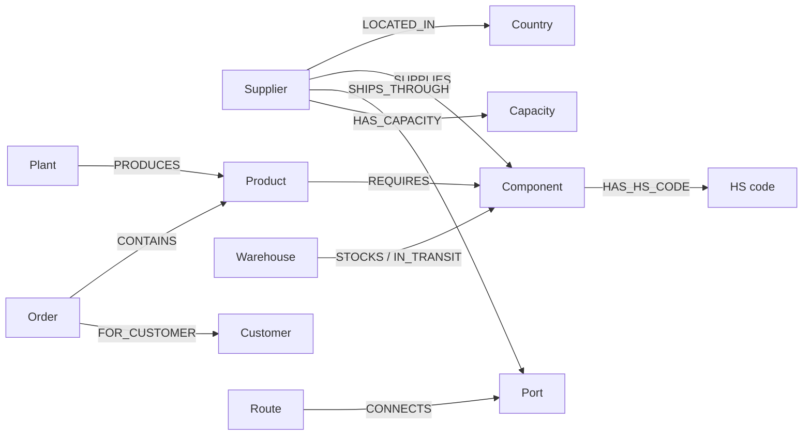

# Data guide

This document explains the committed demo data, the relationships between records, the calculations built from them, and the evidence created during a run. All companies, prices, capacities, orders and policy events are synthetic.

Read alongside [Architecture](ARCHITECTURE.md) and [LangChain stack](LANGCHAIN_STACK.md).

## 1. Sources of data

| Source | Purpose | Owner / how it changes |
| --- | --- | --- |
| [`seed_supply_chain.json`](../backend/data/seed_supply_chain.json) | Healthy supply-chain entities and relationships | Committed fixture; loaded at startup |
| [`tariff_event.json`](../backend/data/tariff_event.json) | Policy scope, rate, announcement time and effective time | Committed event; loaded when `SupplyTools` is constructed |
| [`generate_data.py`](../scripts/generate_data.py) | Reproduces both JSON fixtures | Running it **overwrites both files**, including manual event edits |
| Graphiti / Neo4j | Persisted supply topology, episodes, curated facts and historical versions | Used when `MEMORY_MODE=graphiti` |
| `runtime/memory-{mode}.sqlite` | Episode/fact journal; full fallback memory in local mode | Written by `TemporalMemory`; also used for local provenance and duplicate checks in Graphiti mode |
| `runtime/checkpoints.sqlite` | LangGraph execution checkpoints | Framework-managed execution state, including approval interrupts |
| `runtime/incident-{memory_mode}-{agent_mode}.json` | Current incident, activity events, proposed plan and graph overlays | Application-managed state; reset creates a fresh incident |

Graphiti mode seeds the committed topology into Neo4j, then reads it back into `SupplyTools`. Subsequent graph traversal is controlled Python traversal over that loaded snapshot. It is not a new database query for every hop. Policy evidence is also retrieved from Graphiti during impact analysis. Local mode loads the fixture directly and uses the SQLite temporal journal.

## 2. What the company looks like

The healthy graph has **68 entities and 123 relationships**.

| Entity type | Count | IDs / meaning |
| --- | ---: | --- |
| Country | 4 | `CN` China, `TW` Taiwan, `VN` Vietnam, `DE` Germany |
| HSCode | 4 | `8542`, `8532`, `8504`, `8473`; synthetic tariff classifications |
| Supplier | 8 | `A`–`H` |
| Capacity | 8 | `cap-A`–`cap-H`; visible spare-capacity records |
| Component | 12 | MCU, PMIC and ten other electronic parts |
| Product | 5 | Gateway, controller, monitor, hub, power station |
| Plant | 2 | `plant-0` Berlin Assembly, `plant-1` Dresden Assembly |
| Warehouse | 3 | Berlin, Hamburg and Dresden hubs |
| Port | 4 | Shenzhen, Kaohsiung, Hai Phong and Hamburg |
| Route | 3 | Three origin-port routes to Hamburg |
| Order | 10 | `order-0`–`order-9`, displayed as SO-4100–SO-4109 |
| Customer | 5 | `customer-0`–`customer-4` |

Policy and mitigation nodes appear in the UI during an incident and are **additional projections**, not part of the original 68-node fixture. Graphiti also stores episode nodes, evidence-value nodes and provenance edges, so its raw database totals exceed the healthy UI counts.

## 3. JSON structure and identifiers

The seed file has two arrays:

```json
{
  "nodes": [
    {
      "id": "A",
      "name": "Shenzhen Micro",
      "type": "Supplier",
      "attributes": {
        "country": "CN",
        "available_capacity": 8000,
        "lead_days": 12,
        "currency": "EUR"
      }
    }
  ],
  "edges": [
    {
      "id": "A:SUPPLIES:mcu",
      "source": "A",
      "target": "mcu",
      "predicate": "SUPPLIES",
      "attributes": {
        "unit_price": 8,
        "freight": 0.5,
        "expedite_premium": 0.5,
        "qualified": true
      }
    }
  ]
}
```

This is an abbreviated schema example, not a replacement seed file. Node IDs are unique. Relationship IDs use `source:predicate:target`. Every edge endpoint must exist; Pydantic validates duplicate IDs and dangling references in [`entities.py`](../backend/models/entities.py).

Graphiti UUIDs are stable UUID5 values derived from a namespace and these IDs; business ID `A` is not the raw Neo4j UUID. The adapter preserves business IDs in `entity_id`. Entity attributes and seed-edge attributes are stored as `properties_json` and reconstructed when loading the supply graph.

## 4. Relationship dictionary

Arrows below show the **stored direction**. An investigation can traverse these relationships in reverse.

| Relationship | Count | Stored direction | Relevant properties |
| --- | ---: | --- | --- |
| `LOCATED_IN` | 8 | Supplier → Country | Country is also duplicated on supplier attributes for filtering |
| `SUPPLIES` | 15 | Supplier → Component | Unit price, freight, qualification, optional expedite premium |
| `HAS_HS_CODE` | 12 | Component → HSCode | Component also carries `hs_code` for filtering |
| `REQUIRES` | 27 | Product → Component | `bom_quantity`: component units per finished unit |
| `PRODUCES` | 5 | Plant → Product | Which plant makes each product |
| `STOCKS` | 12 | Warehouse → Component | On-hand `quantity` |
| `IN_TRANSIT` | 2 | Warehouse → Component | Incoming `quantity` and `arrival` date |
| `CONTAINS` | 10 | Order → Product | Finished-product `quantity` |
| `FOR_CUSTOMER` | 10 | Order → Customer | Customer receiving the order |
| `SHIPS_THROUGH` | 8 | Supplier → Port | Used to find the supplier's port delay |
| `CONNECTS` | 6 | Route → Port | Each route has two endpoint edges |
| `HAS_CAPACITY` | 8 | Supplier → Capacity | Displayable capacity constraint |



In Neo4j, seeded business relationships are Graphiti `RELATES_TO` edges with the business predicate in their `name` property. For example, `SUPPLIES` is an edge name, not a separate Neo4j relationship type. Graphiti provenance uses `MENTIONS` relationships.

## 5. Supplier data and the deliberate bottleneck

All capacity figures are units in the single November 2026 planning window. Available capacity means spare capacity **after other commitments**.

| ID | Supplier | Country | Total capacity | Available capacity | Base lead days | Port / extra days |
| --- | --- | --- | ---: | ---: | ---: | --- |
| A | Shenzhen Micro | CN | 8,000 | 8,000 | 12 | Shenzhen / 0 |
| B | Formosa Silicon | TW | 6,000 | **2,000** | 14 | Kaohsiung / 3 |
| C | VietCore Electronics | VN | 5,000 | 1,400 | 10 | Hai Phong / 1 |
| D | Suzhou Logic | CN | 7,000 | 5,000 | 12 | Shenzhen / 0 |
| E | Rhein Power | DE | 9,000 | 6,000 | 4 | Hamburg / 0 |
| F | Hanoi Passives | VN | 15,000 | 10,000 | 8 | Hai Phong / 1 |
| G | Taipei Precision | TW | 8,000 | 5,000 | 9 | Kaohsiung / 3 |
| H | Bavaria Assemblies | DE | 12,000 | 9,000 | 3 | Hamburg / 0 |

Supplier A can dispatch **800 units before the tariff** using a four-day expedited lead time. Other suppliers have zero modeled pre-tariff dispatch capacity, even though the fixture includes an `expedite_lead_days` attribute for them. A and D have regular booked arrivals on **November 17, 2026**.

Capacity is duplicated for visibility: `Supplier.attributes.available_capacity` drives validation, while the linked Capacity node supplies the graph label and capacity metadata. Keep both consistent when editing data.

### Semiconductor offers

Prices and freight below are **EUR per component unit**. This is a synthetic financial model, not a real customs classification or valuation system.

| Component | Supplier | Unit price | Freight | Tariff per unit | Normal landed cost at 25% China tariff |
| --- | --- | ---: | ---: | ---: | ---: |
| MCU | A | 8.00 | 0.50 | 2.00 | 10.50 |
| MCU | B | 8.40 | 0.60 | 0.00 | 9.00 |
| MCU | C | 8.80 | 0.40 | 0.00 | 9.20 |
| PMIC | D | 4.00 | 0.30 | 1.00 | 5.30 |
| PMIC | G | 4.50 | 0.30 | 0.00 | 4.80 |

A's expedited MCU costs `8.00 + 0.50 + 0.50 = €9.00` with no tariff if it arrives before activation. B looks cheaper than A, but cannot absorb all MCU procurement. This is why the first proposal fails.

## 6. Component and product data

| Component ID | Display name | HS code | Qualified supplier IDs |
| --- | --- | --- | --- |
| `mcu` | MCU · X7 | 8542 | A, B, C |
| `pmic` | Power IC · P4 | 8542 | D, G |
| `radio` | Radio module | 8473 | E |
| `sensor` | Optical sensor | 8473 | F |
| `cap` | Ceramic capacitor | 8532 | G |
| `psu` | Power supply | 8504 | H |
| `pcb` | Mainboard | 8473 | E |
| `case` | Enclosure | 8473 | F |
| `screen` | OLED display | 8473 | G |
| `cable` | Cable harness | 8473 | H |
| `fan` | Cooling assembly | 8473 | E |
| `connector` | I/O connector | 8473 | F |

All BOM quantities are currently **one**. Every product requires `pcb`, `case` and `cable` in addition to the parts shown below.

| Product | Additional components | Plant | Gross margin |
| --- | --- | --- | ---: |
| Edge Gateway | MCU, PMIC, radio | Berlin | 34% |
| Smart Controller | MCU, PMIC, sensor | Dresden | 41% |
| Vision Monitor | MCU, PMIC, capacitor | Berlin | 38% |
| Connect Hub | MCU, PMIC, power supply | Dresden | 29% |
| Power Station | None in the simplified fixture | Berlin | 26% |

Power Station is intentionally outside the semiconductor impact path. Screen, fan and connector enrich the supplier graph but currently have no product BOM demand. Product names do not imply a complete real-world engineering BOM.

## 7. Orders, customers and inventory

Each product has two open orders. Each of the four semiconductor-dependent products has 575 units per order, giving `4 × 2 × 575 = 4,600` units of MCU demand **and** 4,600 units of PMIC demand.

| Customer | Product | Order numbers | Combined units | Combined order value | Tariff downstream impact |
| --- | --- | --- | ---: | ---: | --- |
| Atlas Systems | Edge Gateway | SO-4100, SO-4105 | 1,150 | €152,375 | Yes |
| Northstar Labs | Smart Controller | SO-4101, SO-4106 | 1,150 | €158,125 | Yes |
| Helix Industrial | Vision Monitor | SO-4102, SO-4107 | 1,150 | €163,875 | Yes |
| Nova Retail | Connect Hub | SO-4103, SO-4108 | 1,150 | €169,625 | Yes |
| Orbit Health | Power Station | SO-4104, SO-4109 | 600 | €91,500 | No |

The ten orders total **€735,500**; the eight affected orders total **€644,000**. Deadlines are November 25–27, 2026. Each order needs three days of production after component arrival. `gross_margin` is a fraction (`0.41` means 41%), used to prioritize proposed inventory reservations; it is not a monetary amount.

Order quantity exists on both the Order node and its `CONTAINS` edge. Current demand calculations use the **Order node quantity**, and the fixture has one product per order. Keep the duplicate quantity consistent. A multi-line order schema would require changes to the traversal.

| Warehouse | MCU | PMIC | Other components |
| --- | --- | --- | --- |
| Berlin Hub | 400 on hand | 200 on hand | — |
| Hamburg Hub | 200 incoming Nov 5 | 100 incoming Nov 5 | — |
| Dresden Hub | — | — | 20,000 on hand for each of the ten other components |

Incoming stock counts only when its arrival is no later than the earliest dependent order deadline. The current inventory cutoff does not subtract production days; the plan's new-supply arrival checks separately include production time. Existing and incoming stock are assumed imported before tariff activation. Reservations are proposed in gross-margin order, then deadline order; they do not physically move inventory.

## 8. Policy event fields

The supplied event is a 25% tariff on China-origin components in HS 8542, announced **October 26, 2026 at 09:00 UTC**, effective **November 15, 2026 at 00:00 UTC**.

| Field | Meaning / validation |
| --- | --- |
| `id` | Business identifier for the policy event |
| `name` | Human-readable title; should match the rate and scope |
| `simulated` | Labels the event as synthetic; keep `true` for this demo |
| `country` | Country ID used to match supplier `country` attributes |
| `hs_code` | Exact string match against component `hs_code` |
| `rate` | Fraction greater than zero and at most one; `0.25` means **25% total**, not an additive change |
| `reference_time` | When the announcement occurred; also anchors the modeled lead-time calculations |
| `effective_at` | When the tariff activates; used to validate expedited supply |
| `description` | Text given to the Commander; should agree with the structured fields |

Scope requires **both** country and HS code to match. The default event directly affects A, D, MCU and PMIC. Its downstream effects are four products, two plants, eight orders and four customers: **18 downstream entities**, separate from the four directly affected entities.

Propagation is a business dependency walk, not a literal forward-only graph traversal. For example, `Product → REQUIRES → Component` must be followed backwards to find products affected by a component.

## 9. Reproduce the numbers

Calculations live in [`calculation_tools.py`](../backend/tools/calculation_tools.py) and [`supply_tools.py`](../backend/tools/supply_tools.py). Monetary results are rounded to two decimals.

```text
MCU shortfall  = 4,600 − 400 − 200 = 4,000 units
PMIC shortfall = 4,600 − 200 − 100 = 4,300 units

Pre-tariff procurement = 4,000 × €8.50 + 4,300 × €4.30 = €52,490
Baseline tariff        = 4,000 × €8.00 × 25% + 4,300 × €4.00 × 25% = €12,300
Tariff scenario        = €52,490 + €12,300 = €64,790
```

The rejected first plan gives B all 4,000 MCU units and retains D's 4,300 PMIC units. B's available 2,000-unit capacity makes it infeasible.

| Revised allocation | Quantity | Landed unit cost | Total |
| --- | ---: | ---: | ---: |
| B / MCU | 1,600 | €9.00 | €14,400 |
| C / MCU | 1,200 | €9.20 | €11,040 |
| A / MCU expedited | 800 | €9.00 | €7,200 |
| A / MCU regular | 400 | €10.50 | €4,200 |
| G / PMIC | 4,300 | €4.80 | €20,640 |
| **Total** | **8,300** | | **€57,480** |

Savings are `€64,790 − €57,480 = €7,310`. Incremental cost over the pre-tariff baseline is `€57,480 − €52,490 = €4,990`. Residual tariff is `400 × €8 × 25% = €800`; tariff reduction is `(€12,300 − €800) / €12,300 = 93.50%`.

These compare **affected component procurement**, not company-wide costs. All eight orders count as protected only if the entire proposed plan passes the modeled constraints. Residual risks include port delays and PMIC concentration at G. There is no probabilistic risk score or complex optimization solver.

## 10. Evidence, time and provenance

The seed graph describes the business network. A run adds episodes and curated facts:

| Kind | Example | Interpretation |
| --- | --- | --- |
| `OBSERVATION` | Tariff scope or calculated landed cost based on a trusted fixture | An observed/model-derived input fact |
| `INFERENCE` | Downstream exposure or a capacity validation conclusion | A conclusion from controlled tools |
| `DECISION` | Approved mitigation plan ID with supporting plan/evaluation episode | A human-approved decision |

Each proposed fact contains `subject`, `predicate`, `object`, `source_episode`, `confidence`, `reason`, `kind` and `valid_at`. Confidence is a validation field; fixture-derived facts currently use `1.0`, not an LLM-calibrated probability.

The curator allows `EFFECTIVE_LANDED_COST`, `HAS_EXPOSURE`, `CAPACITY_VERIFIED` and `MITIGATION_DECISION`. It requires a known subject, a source episode, confidence ≥0.90 and explicit approval for decisions. Some investigation results remain episode bodies rather than standalone fact edges.

For a subject and predicate, a newer fact invalidates the prior current fact using `invalid_at`. Historical records remain. `created_at` captures ingestion time in Graphiti; `valid_at` captures modeled business time. A replay clock advances across demo resets, avoiding older critic findings overwriting newer findings. Policy announcement time itself stays fixed.

The UI overlays healthy/affected/critical/alternative/mitigated states from incident activity. Its Policy, Mitigation, `APPLIES_TO` and `ALLOCATES` projections are not a raw dump of every Neo4j node and edge. The before/current toggle is a baseline projection; `/api/memory?subject=A&as_of=...` performs temporal evidence retrieval.

## 11. Editing safely

1. Change fixture attributes and preserve IDs and edge endpoints. Keep duplicated capacity, country, HS and quantity fields consistent.
2. Keep the event's `rate`, `name`, `description`, country and dates consistent. `0.50` means 50% total; a 25-percentage-point increase from 25% gives 50%.
3. Restart the backend and reset the demo. The running process does not hot-reload JSON fixtures.
4. Run `uv run pytest -q`; tests encode the original demo's expected quantities and failure/recovery sequence.

The current UI/API does not accept a custom policy payload. The planner, deliberate rejection, some graph labels and some narrative text assume the original China/8542 scenario. Changing countries is not currently supported end to end just by editing the JSON. Changing the rate also requires checking whether the fixed portfolio still makes economic sense; feasibility validation does not guarantee that a plan saves money.

This fixture is designed for one procurement window. It omits FX conversion, duties by destination, real customs rules, multi-period inventory, manufacturing-line capacity, multi-item orders and automatic ERP execution. Routes provide context; lead-time validation uses supplier and port attributes rather than a route optimizer.
