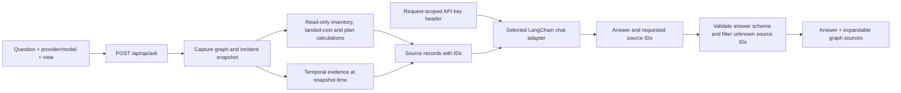

# Ask the knowledge graph

The graph has a read-only **Ask graph** panel. Choose a local or hosted model and ask about suppliers, BOM dependencies, costs, inventory, incident exposure or mitigation evidence. This model selection is independent of `AGENT_MODE`: you can keep the repeatable incident investigation in deterministic mode while using a real LLM for questions.

## Using the panel

1. Click **Ask graph** in the graph's upper-right corner. It also works in graph fullscreen mode.
2. Select a provider and model. Choose **Custom model ID…** to enter another model supported by that provider.
3. For a hosted model, enter that provider's API key. For Ollama, start the local service and pull the selected model first.
4. Enter a question, then click **Ask graph** in the panel.
5. Expand the answer's **Graph sources** to inspect its inputs. **Highlight entity** selects a referenced entity in the graph.

Examples:

- “Which products depend on the MCU?”
- “What is Formosa Silicon's available capacity?”
- “Why was the first sourcing plan rejected?”
- “Compare the landed costs for MCU suppliers.”
- “What risks remain after the proposed mitigation?”

Questions use the selected **Before disruption / Current** view. Selecting a node supplies a focus hint while preserving the full network context. Switching views clears the old answer. Each answer records its snapshot time and incident status; it is not automatically regenerated as an investigation progresses.

The provider catalog checks the configured Ollama service for installed models. Installed tags appear before the presets and are selected by default when the panel opens. If Ollama is offline, the normal presets and hosted choices remain available.

## Models and providers

| Provider | Presets | What is required |
| --- | --- | --- |
| Ollama | `qwen3:8b`, `mistral:7b`, `llama3.1:8b` | Ollama running on the backend host, with the chosen model installed |
| OpenAI | `gpt-4.1-mini`, `gpt-4.1` | OpenAI API key with model access |
| Anthropic | `claude-sonnet-5-5`, `claude-haiku-5-5` | Anthropic API key with model access |
| Google Gemini | `gemini-3.8-flash`, `gemini-3.5-flash-lite` | Gemini API key with model access |

These are presets, not a live catalog of account entitlements or a promise that every model is available to every account. Use a custom model ID if needed. The IDs were checked against provider/model documentation on October 27, 2026. Providers can change access or retire models.

Qwen3 and Mistral are offered as open-source choices. Llama is labelled **open weights**, because model licenses are not interchangeable. Model distribution and license details remain the model publishers' responsibility. Relevant model pages: [Qwen3](https://ollama.com/library/qwen3), [Mistral](https://ollama.com/library/mistral), [Llama 3.1](https://ollama.com/library/llama3.1), [Claude models](https://platform.claude.com/docs/en/models/overview), [Gemini models](https://ai.google.dev/gemini-api/docs/models).

### Local setup with Ollama

Install [Ollama](https://ollama.com/), then run:

```bash
ollama serve
ollama pull qwen3:8b
```

If the Ollama desktop app already serves requests, another `ollama serve` is unnecessary. Select the exact pulled tag in the panel. For another model, pull it first and use its custom tag; choose a model that can accommodate the graph context. The backend requests a 32,768-token context window, so hardware/model requirements can be significant.

The app does not install Ollama or download model weights automatically. The default connection is `http://127.0.0.1:11434`, configured through server-side `OLLAMA_BASE_URL`. “Local” means local to the backend host; a remotely configured Ollama endpoint receives the supplied graph and question too.

### Imported Jan model on this workstation

Ollama was installed through Homebrew and started as a background service. The existing Jan file was imported without downloading model weights:

```text
/Users/akarshrajsingh/jan/models/mistral-ins-7b-q4/mistral-7b-instruct-v0.2.Q4_K_M.gguf
```

Its Ollama tag is **`mistral-ins-7b-q4:latest`**. Select **Ollama** in Ask graph, then this installed model. No API key is needed. The original Jan model stays in place; Ollama maintains its own local model store.

The machine-specific import recipe is in ignored `runtime/ollama/Modelfile`. To recreate this registration on the same machine:

```bash
brew services start ollama
ollama create mistral-ins-7b-q4 -f runtime/ollama/Modelfile
ollama list
```

The Modelfile points `FROM` to the GGUF above, supplies the Mistral `[INST]` prompt template, and uses a 32,768-token context. It is not committed because it contains a machine-specific absolute path. `brew services stop ollama` stops the background service if needed. Do not try `ollama pull mistral-ins-7b-q4`: this is an imported local name, not a public model-library tag.

Real local inference was verified on this machine. The full-snapshot question initially exceeded the request timeout; bounded local retrieval reduced the test context from about 49,500 to 6,100 characters. Mistral then answered the Supplier B spare-capacity question correctly in about 12.5 seconds with a valid calculation citation. It also emitted an invalid source ID, which the app filtered and flagged. A subsequent browser-to-backend-to-Ollama check completed in 10.9 seconds, returned the correct 2,000-unit answer, and had a valid `C:offers` citation with no citation warnings. Latency and answer quality vary with the question, hardware, and whether the model is already loaded.

## Credential handling

Hosted provider keys are entered as masked fields and sent to the backend in the `X-LLM-API-Key` header for that request. They are held in memory, not saved to `.env`, local storage, incident JSON, graph memory or checkpoints. Closing the panel or changing provider clears the UI key. Requests use a fresh provider adapter and do not overwrite server environment variables or reuse another user's key.

Q&A deliberately disables LangSmith tracing, even when incident tracing is enabled. Provider errors are mapped to safe messages; logs record the provider and exception class, not raw provider error text. Graph snapshots and questions are sent to the selected model provider, as indicated in the panel. Q&A requires an explicitly entered key for hosted models; it does not silently consume the backend's incident-agent API key.

This remains a trusted, single-user local application without authentication. The Q&A endpoint does not expose arbitrary provider endpoint URLs to callers. Hosted traffic uses the provider adapters; local Ollama's address is configured on the server.

## How grounding works



Implementation:

- [`backend/models/questions.py`](../backend/models/questions.py): bounded question/answer schemas and allowed providers.
- [`backend/qa.py`](../backend/qa.py): provider catalog, current adapters, snapshot construction, source indexing, inference and safe errors.
- [`backend/api/main.py`](../backend/api/main.py): `GET /api/qa/models` and `POST /api/qa/ask`.
- [`GraphQuestions.tsx`](../frontend/src/components/GraphQuestions.tsx): provider/model/key form, question, answer and source inspection.
- [`tests/test_questions.py`](../tests/test_questions.py): grounding scope, temporal isolation, request-key handling, error redaction and adapter construction.

Source IDs use these prefixes:

| Prefix | Meaning | Example |
| --- | --- | --- |
| `N:` | Graph node and attributes | `N:B` |
| `R:` | Relationship and its properties | `R:B:SUPPLIES:mcu` |
| `C:` | Deterministic calculation | `C:inventory`, `C:offers`, `C:impact`, `C:plan`, `C:rejection` |
| `F:` | Temporal evidence included in this snapshot | `F:1` |

The backend builds a complete graph/evidence snapshot, including calculated offer costs and inventory. Hosted models receive that snapshot. To keep local inference practical, Ollama receives a bounded subset selected by entity-name/ID matches, the selected-node hint, one or two relationship hops, and question-relevant calculations. A lightweight entity-name index retains the network's labels. Numeric values are preserved; unavailable attributes must not be guessed. This is deterministic retrieval, not a semantic vector search or LLM-generated Cypher.

Active incidents include computed exposure and the current candidate assessment when relevant. Temporal evidence is read at the captured snapshot's valid time; before/healthy views exclude incident findings. Large evidence objects are summarized to reasons and provenance, while calculations supply numeric inputs. Citation validation accepts only source records included in the selected model context.

The selected LLM receives no action tools. The service does not write organizational memory, approve a mitigation or execute sourcing. Its computed assessment does not change the Critic's recorded workflow status.

## Accuracy and verification limits

The model is instructed to use only the supplied data and cite supporting source IDs. The backend verifies that those IDs exist and drops unknown references. **That does not prove the prose is factually entailed by each source.** Inspect source records for important claims. Missing citations produce a visible warning. Invalid/incomplete model JSON, unavailable local models, rejected keys, rate limits and timeouts produce explicit errors.

Backend tests exercise the adapters and service using controlled model responses, including a provider error containing a dummy secret. Browser checks cover provider selection, key fields, questions, citations, fullscreen and view changes. Actual local inference was subsequently verified using the imported Mistral model described above. Hosted inference still requires valid credentials and has not been exercised. The app never presents a stub response as a real model answer.

Official integration references: [ChatOllama](https://docs.langchain.com/oss/python/integrations/chat/ollama), [ChatOpenAI](https://docs.langchain.com/oss/python/integrations/chat/openai), [ChatAnthropic](https://docs.langchain.com/oss/python/integrations/chat/anthropic), [ChatGoogleGenerativeAI](https://docs.langchain.com/oss/python/integrations/chat/google_generative_ai).
