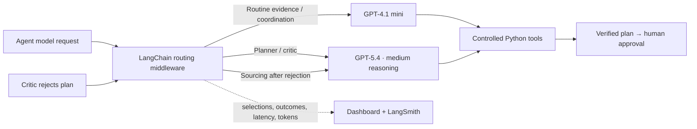

# Model routing for the hackathon demo

Live incident agents select a model before **each actual model invocation**, using LangChain `AgentMiddleware.awrap_model_call` and `request.override(model=...)`. The middleware runs in Commander and each specialist. The selection policy is explicit Python code, not an LLM guessing task difficulty.

| Task | Default model | Reason |
| --- | --- | --- |
| Commander | GPT-4.1 mini | Follow the delegation sequence and track status |
| Policy, impact, inventory | GPT-4.1 mini | Retrieve structured evidence and report tool results |
| Initial sourcing | GPT-4.1 mini | Look up qualified supplier offers |
| Mitigation planner | GPT-5.4, medium reasoning | Explain proposal trade-offs |
| Risk / Critic | GPT-5.4, medium reasoning | Review constraints and explain residual risks |
| Sourcing after critic rejection | **Escalates to GPT-5.4** | Reconsider alternatives with the rejection evidence |

The official OpenAI documentation describes [GPT-4.1 mini](https://developers.openai.com/api/docs/models/gpt-4.1-mini) as a small, low-latency model with tool calling, and [GPT-5.4](https://developers.openai.com/api/docs/models/gpt-5.4) as a reasoning-capable model for complex professional work. Defaults retain the previously configured routine model. Account access must allow both models; configure alternatives explicitly if necessary.



## Configuration

Set in the ignored `.env` and restart the backend:

```dotenv
AGENT_MODE=live
MODEL_ROUTING=cost-aware
OPENAI_ROUTINE_MODEL=gpt-4.1-mini
OPENAI_THINKING_MODEL=gpt-5.4
OPENAI_THINKING_EFFORT=medium
```

`OPENAI_ROUTINE_MODEL` defaults to the existing `OPENAI_MODEL`. `OPENAI_THINKING_MODEL` defaults to `gpt-5.4`. GPT-5 / o-series models use the Responses API (including function tools with reasoning) and omit `temperature`; the thinking route sends the configured reasoning effort. Non-reasoning model overrides do not receive that parameter. Use an effort supported by the configured model. Provider errors are displayed; the app does not silently fall back to a different model.

`MODEL_ROUTING=single` uses `OPENAI_MODEL` for every role, providing a comparison baseline. `AGENT_MODE=deterministic` uses scripted calls regardless of routing settings; its UI labels them scripted. Model settings are server-side rather than arbitrary client inputs. Q&A has its own separate provider selection.

Existing incidents keep their recorded routing policy. Runs predating this feature are labelled as the previous single-model path and have no fabricated call history. Their original model name and usage are unknown; configured model fields are not proof of historical calls. **Reset demo**, then inject a new event to demonstrate routing after a restart. Avoid changing routing configuration while a human approval checkpoint is pending; finish that run first.

## What to show the judges

1. Start a fresh live incident. In **Agent activity**, open **Models**.
2. Point to routine calls using the cheaper model, with actual completion status and reported tokens.
3. Watch the planner and critic use the thinking model. The first plan is rejected for exceeding supplier capacity.
4. Show sourcing switch from the routine model to the thinking model on its next invocation after rejection.
5. Open **Run evidence** for the complete call history and downloadable JSON. Expand calls to show the routing reason, reasoning effort, elapsed time and input/output tokens.
6. In LangSmith, expand **Model route · role-name** spans and the nested real model calls. The route spans include the reason, tier, model, incident ID, outcome and usage. Tracing-only keys can ingest this evidence; no feedback/dataset permission is required.

Model-call duration includes the model handler and any provider retry; it is not pure network latency. Usage is recorded when returned by the provider. Failed calls may have unknown usage. Token counts include reported output tokens, which can include reasoning tokens. Model-route records do not expose private reasoning or credentials.

This demonstrates task-based model selection and escalation. It does **not** establish measured cost savings or better plan quality. To measure those, run the same regression dataset in separate processes with `MODEL_ROUTING=single` and `MODEL_ROUTING=cost-aware`, both with `--mode live`, then compare provider usage and process checks. Prices and task outcomes vary; the dashboard does not invent dollar savings.

If the cheaper Commander requests approval before revision verification, the approval tool returns a blocked result and the next required specialist. Once a revised plan is independently verified, routing middleware constrains the Commander’s next call to the approval-request tool to prevent unnecessary replanning. That tool still independently enforces feasibility and pauses for a human; it never auto-approves.

Python still builds candidate allocations, computes costs and enforces constraints. A stronger model reviews and explains tool evidence; it does not replace the numerical engine or the human approval gate.

Implementation: [`routing.py`](../backend/agents/routing.py), [`commander.py`](../backend/agents/commander.py), [`ModelRouting.tsx`](../frontend/src/components/ModelRouting.tsx). Tests cover actual request override, escalation, model parameter compatibility, usage, errors, offline mode and the single-model baseline.

## Verified live run (2026-10-27)

A credentialed isolated run used GPT-4.1 mini for routine roles and GPT-5.4 with medium reasoning for planning/critique. Sourcing switched from GPT-4.1 mini to GPT-5.4 after rejection. The run reached the durable human interrupt and resumed with a synthetic rejection fixture. All ten process checks passed; provider usage was recorded and LangSmith ingestion reported no errors. Investigation trace: `01a17ead-7281-7841-92d1-8a9b4d3e4560` in the EU `supplychain-copilot` project. Decision trace: `01a17eaf-f79b-7850-9b1b-f4ff29ea6769`. The dashboard incident was not changed by this test.

Validation: 40 Python tests passed, one optional Neo4j test skipped; frontend build and the read-only routing browser test passed. This validates execution and routing, not a quality or cost benchmark.
